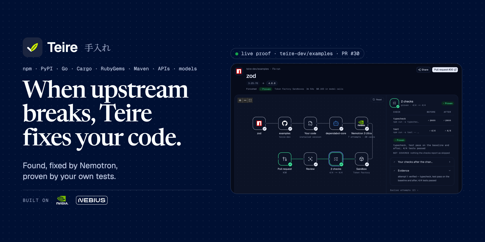
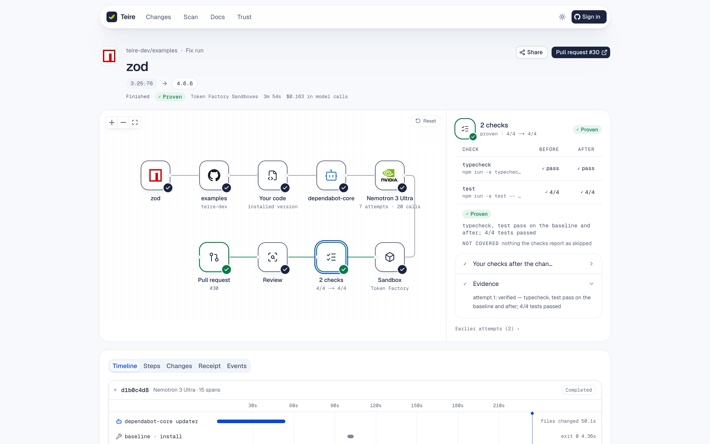
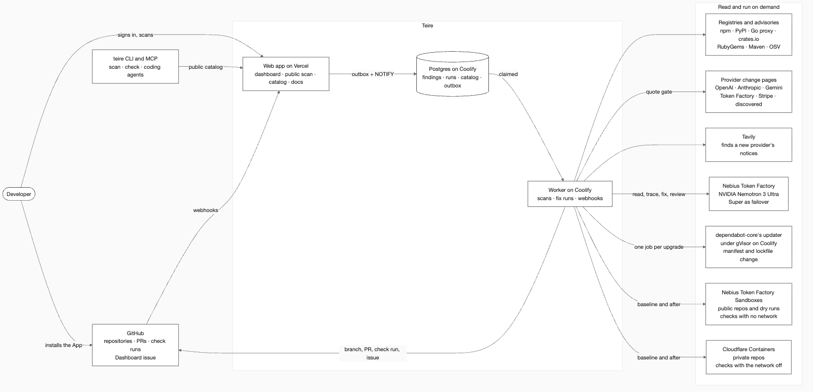

  <a href="https://teire.vercel.app">
    <picture>
      <source media="(prefers-color-scheme: dark)" srcset="assets/banner-dark.png" />
      <source media="(prefers-color-scheme: light)" srcset="assets/banner-light.png" />
      
    </picture>
  </a>

<h2 align="center">When upstream breaks, Teire fixes your code.</h2>

When a package, an API or an AI model your code depends on changes, Teire finds the lines that break, fixes them, and proves the fix with your own tests.

  <a href="https://github.com/apps/teire-bot"><b>Install the GitHub App</b></a>
  &nbsp;·&nbsp;
  <a href="https://teire.vercel.app/scan"><b>Scan a public repo</b></a>
  &nbsp;·&nbsp;
  <a href="https://teire.vercel.app/docs"><b>Docs</b></a>
  &nbsp;·&nbsp;
  <a href="https://www.npmjs.com/package/teire-cli"><b>CLI and MCP</b></a>
  &nbsp;·&nbsp;
  <a href="https://teire.vercel.app/trust"><b>Live status</b></a>

**Teire** (手入れ, Japanese for "care and upkeep") looks after the things your code depends on but someone else changes: open-source packages, payment APIs, AI models.

### The problem

When something your app depends on changes, someone has to:

1. notice it happened;
2. work out whether it touches the code;
3. find every line that does;
4. change those lines;
5. prove the app still works.

Nobody owns this chore, so it waits until something breaks. On 2026-10-23 OpenAI shut down `gpt-3.5-turbo`, `gpt-4` and `o3-mini`; that day [inspect_ai's live tests failed](https://github.com/meridianlabs-ai/inspect_ai/issues/601) with `404 model_not_found`, and the next morning the commit tool gitted [failed on every call](https://github.com/yegor256/gitted/issues/176). The notice had been out for six months. Dependabot and Renovate bump versions but leave the broken code to you, and a retired model isn't a new version, so they open nothing.

### What Teire does

Install Teire on a repository and it watches every dependency and API the code uses:
- six package ecosystems (npm, PyPI, Go, Cargo, RubyGems, Maven/Gradle);
- the AI and payment APIs the code calls;
- the runtimes it is pinned to.

When a change reaches your code, Teire:

1. **finds the exact lines** by diffing the package's public API between your version and the target, or by finding the model ID and API calls in your code;
2. **fixes them**: a plain swap where the source names one, and otherwise a coding agent, **NVIDIA Nemotron 3 Ultra on Nebius Token Factory**;
3. **proves it** by running your own install, typecheck and tests before and after, in two sandboxes with the network off;
4. **opens a pull request** with the quoted source, the call sites, the before/after table and the cost of every model call. When it can't prove a fix, it says so: a draft, or an issue for a person.

  

### How it works

  <picture>
    <source media="(prefers-color-scheme: dark)" srcset="assets/system-dark.png" />
    <source media="(prefers-color-scheme: light)" srcset="assets/system-light.png" />
    
  </picture>

### Built on

| | |
|---|---|
| **Nebius Token Factory** | Every model call, with an exact receipt from its public prices |
| **NVIDIA Nemotron 3 Ultra** | Fixes the code as an agent, reads change pages Teire has no parser for, traces model IDs hidden in registries, reviews every passing diff. Nemotron 3 Super is the failover |
| **Cloudflare Containers** | The sandboxes where your install, typecheck and tests run, before and after |
| **Tavily** | Finds the deprecation pages of API providers Teire discovers in your code |

### Repositories

| Repository | What it is |
|---|---|
| [**teire**](https://github.com/teire-dev/teire) | The product: the GitHub App, web app, worker, engine, CLI and MCP server |
| [**examples**](https://github.com/teire-dev/examples) | Small real projects that reproduce each breakage Teire fixes, plus false-positive checks |

### Try it

- **On your repository:** [install the GitHub App](https://github.com/apps/teire-bot). It opens a "Configure Teire" pull request; merge it to turn Teire on.
- **Without installing:** [scan any public repository](https://teire.vercel.app/scan) and dry-run a fix.
- **From a terminal or a coding agent:** `npx teire-cli scan owner/name`, or add the MCP server with `claude mcp add teire -- npx -y teire-cli mcp`.

Built for the Nebius × NVIDIA Global AI Hackathon. MIT licensed.
